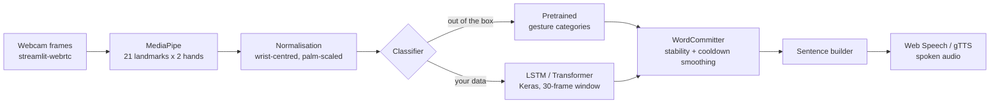

# SignAI - Real-Time Sign Language Recognition

[](https://share.streamlit.io/deploy?repository=Daniyal2005-dh/sign-language-recognition&branch=main&mainModule=app.py)

**🎯 Live app: <https://sign-language-rec.streamlit.app/>** — open it, allow the camera, and start signing.

Turn hand signs into words and speech, live from your webcam.

**Stack:** Python · OpenCV · MediaPipe (21 hand landmarks) · TensorFlow/Keras (LSTM & Transformer) · scikit-learn · Streamlit · streamlit-webrtc · gTTS / Web Speech

| | |
|---|---|
| **CI** | unit tests on Python 3.11 & 3.12 ([`.github/workflows/ci.yml`](.github/workflows/ci.yml)) |
| **Deploy target** | Streamlit Community Cloud (free) |
| **Language scope** | American Sign Language (ASL) prototype; architecture is vocabulary-agnostic |

---

## What it does

1. **Webcam input** - live video in the browser via WebRTC (no local install needed on the deployed app).
2. **Hand detection** - MediaPipe tracks 21 3D landmarks per hand (up to 2 hands).
3. **Feature extraction** - landmarks are translated to the wrist, scaled by palm size, and packed into a 126-dim feature vector per frame (`63 x 2` hands).
4. **Classification** - either pretrained MediaPipe hand-pose categories (works out of the box) **or your own** LSTM / Transformer trained on collected sequences.
5. **Text & speech** - recognised signs build a sentence you can edit, speak (Web Speech API or gTTS), copy, and review with history + statistics.

> **Important honesty note.** Sign languages are full languages: meaning depends on handshape,
> movement, facial expression, body posture and context. This project is an **educational
> prototype** that recognises a limited set of hand poses/short sequences - it is **not** a sign
> language translator, and ASL is not universal (e.g. Pakistan Sign Language differs). Models
> trained here should be evaluated on unseen signers before any claim of accuracy.

---

## Architecture



**Feature geometry:** one hand = `21 landmarks x (x, y, z) = 63` features. A frame = `63 x 2 = 126`
numbers (second hand slot is zeros when absent, masked out in the models). A dynamic sample =
`T = 30` consecutive frames, i.e. a `(30, 126)` tensor per sign.

---

## Quickstart (local)

```bash
git clone https://github.com/Daniyal2005-dh/sign-language-recognition.git
cd sign-language-recognition

python -m venv .venv
.venv\Scripts\activate                # Windows  (Linux/macOS: source .venv/bin/activate)
pip install -r requirements.txt       # app dependencies (MediaPipe, Streamlit, ...)

streamlit run app.py                  # open http://localhost:8501, click START
```

No OpenCV window app? The same recognition loop also runs as a plain desktop demo:

```bash
python real_time_demo.py --speak      # keys: Q quit | C clear | S speak | D toggle drawing
```

(`pip install pyttsx3` once for offline speech in the demo.)

### Built-in demo vocabulary (no training needed)

The pretrained MediaPipe pose classifier is mapped to words **for demonstration only**:

| Hand pose | Demo word | Hand pose | Demo word |
|---|---|---|---|
| Open palm | **Hello** | Thumb down | **Bad** |
| Thumb + index + pinky | **I Love You** | Index pointing up | **You** |
| Index + middle (V) | **Peace** | Closed fist | **Stop** |
| Thumb up | **Good** | | |

These are *pose-to-word mappings*, not ASL dictionary entries. Real ASL words (and signs that
require movement) come from the custom pipeline below.

---

## Train your own model (Level 2 - dynamic signs)

```bash
pip install -r requirements-train.txt        # adds TensorFlow, scikit-learn, matplotlib

# 1. collect data - ~30 one-second samples per sign, more signers = better
python collect_data.py --label hello --samples 30
python collect_data.py --label thankyou --samples 30
python collect_data.py --label thankyou --samples 10 --signer friend2   # second signer!

# (no webcam handy? generate synthetic data to test the pipeline end-to-end)
python scripts/make_dummy_data.py --classes 4

# 2. train + evaluate
python train.py                              # LSTM (default)
python train.py --arch transformer           # Transformer encoder alternative
python train.py --mode static                # single-frame poses -> MLP
python train.py --group-by-signer            # hold out entire signers (recommended)

# 3. use it: sidebar -> "My trained model" -> Load (models/<name>.keras)
streamlit run app.py
```

Good starter ASL word set (one-handed, movement-visible): `hello`, `thankyou`, `yes`, `no`,
`please`, `sorry`, `goodbye`, `help`, `eat`, `drink`, `more`, `finished`.

**Outputs** (in `reports/`):

* `<name>_confusion_matrix.png` - per-class errors, normalised
* `<name>_history.png` - training/validation curves
* `<name>_metrics.json` - accuracy, split sizes, per-class counts

`--group-by-signer` evaluates on people whose data the model never saw - the honest way to
report generalisation. Scikit-learn's `classification_report` gives per-class precision/recall.

For larger vocabularies, see the [WLASL dataset](https://dxli94.github.io/WLASL/) (word-level
ASL, research licence) and [MediaPipe Gesture Recognizer](https://ai.google.dev/edge/mediapipe/solutions/vision/gesture_recognizer)
for custom-model guidance.

---

## Deploy (Streamlit Community Cloud, free)

1. Fork or use this repo, then sign in at [share.streamlit.io](https://share.streamlit.io) with GitHub.
2. **New app** -> pick `Daniyal2005-dh/sign-language-recognition`, branch `main`, file `app.py`.
3. In **Advanced settings** choose **Python 3.11 or 3.12** (MediaPipe wheels), then **Deploy**.
4. Open the app URL, click **START**, allow the camera - the browser streams video to the app,
   all recognition runs server-side.

Notes: the pretrained `.task` models are committed, so no runtime download is needed; use the
**Low** camera quality on the free tier; TensorFlow is intentionally not in `requirements.txt`
(the cloud app stays light - custom LSTM models run locally).

---

## Project structure

```
sign-language-recognition/
├── app.py                  # Streamlit app (deployable entry point)
├── collect_data.py         # CLI webcam data recorder (.npz sequences)
├── train.py                # LSTM / Transformer / MLP training + evaluation
├── real_time_demo.py       # OpenCV-window demo with offline speech
├── src/signai/
│   ├── config.py           # paths, geometry (63/hand, 126/frame), demo vocabulary
│   ├── features.py         # landmark normalisation + frame features (pure NumPy)
│   ├── gestures.py         # rule-based pose classifier (fallback backend)
│   ├── hands.py            # MediaPipe pipeline (GestureRecognizer/HandLandmarker)
│   ├── predict.py          # WordCommitter smoothing + LSTM window inference
│   ├── dataset.py          # loading + signer-aware train/val/test splits
│   ├── model.py            # Keras builders (LSTM, Transformer, MLP)
│   └── speech.py           # Web Speech / gTTS / pyttsx3 helpers
├── scripts/                # model downloader, synthetic-data generator
├── tests/                  # 18 unit tests (pure NumPy, CI-friendly)
├── models/                 # committed .task models; trained models land here
└── reports/                # confusion matrix, curves, metrics (generated)
```

---

## Troubleshooting

| Problem | Fix |
|---|---|
| Camera shows black / permission denied | Allow camera access in the browser bar; close other apps using the webcam |
| WebRTC connects but no video on a corporate network | Symmetric NAT/firewall - add a TURN server to `rtc_configuration` in `app.py` |
| `mediapipe` install fails | Use Python 3.10-3.12 (no 3.13+ wheels); we verified 1.1.1 on 3.12 |
| `libGL.so.1` / apt errors when deploying | The GUI build of OpenCV needs `libGL.so.1`; we ship **headless OpenCV** instead (listed after `mediapipe` in `requirements.txt`) |
| `libEGL.so.1` / `libGLESv2.so.2` errors on Streamlit Cloud | MediaPipe's native libraries need the GL stack - `packages.txt` installs `libegl1`, `libgles2`, `libgl1` via apt at build time. If apt ever fails with "Unable to locate package", it is a transient platform issue - retry the build |
| Custom model tab says TensorFlow missing | `pip install -r requirements-train.txt` (intentionally not in cloud requirements) |
| Same word commits repeatedly | Raise *Cooldown* / *Stability* sliders, or lower your hand between signs |
| Low FPS in the cloud | Switch sidebar camera quality to **Low**; run heavy use locally |

---

## Roadmap

- [ ] Two-handed dynamic ASL vocabulary (features already support 126-dim two-hand frames)
- [ ] Signer-independent benchmarking on a public dataset (WLASL)
- [ ] Attention pooling / Transformer scaling experiments vs LSTM
- [ ] Facial-expression and body-pose features (MediaPipe Face/Poses)
- [ ] PSL (Pakistan Sign Language) vocabulary pack - the architecture is language-agnostic
- [ ] Model export for on-device inference (TFLite)

## Credits

- [MediaPipe](https://ai.google.dev/edge/mediapipe) (Apache-2.0) - hand landmarks & pretrained gestures
- [streamlit-webrtc](https://github.com/whitphx/streamlit-webrtc) - browser camera in Streamlit
- TensorFlow/Keras, scikit-learn, OpenCV, Streamlit communities

## License

[MIT](LICENSE) - (c) 2026 Daniyal Hussain
